<!-- ═══════════════════════  HEADER BANNER  ═══════════════════════ -->
<div align="center">


<a href="https://git.io/typing-svg"></a>

<br/>


**Deep Learning · Practical Report 6 (PR 6) · Red & White Skill Education**

[📓 **Notebook**](DL_PR6.ipynb) &nbsp;•&nbsp; [🌐 **HTML Export**](DL_PR6.html) &nbsp;•&nbsp; [🖼️ **Plots**](plots/) &nbsp;•&nbsp; [🎥 **Video**](#-video-walkthrough) &nbsp;•&nbsp; [📊 **Results**](#-results-at-a-glance)

</div>

<br/>

<div align="center">
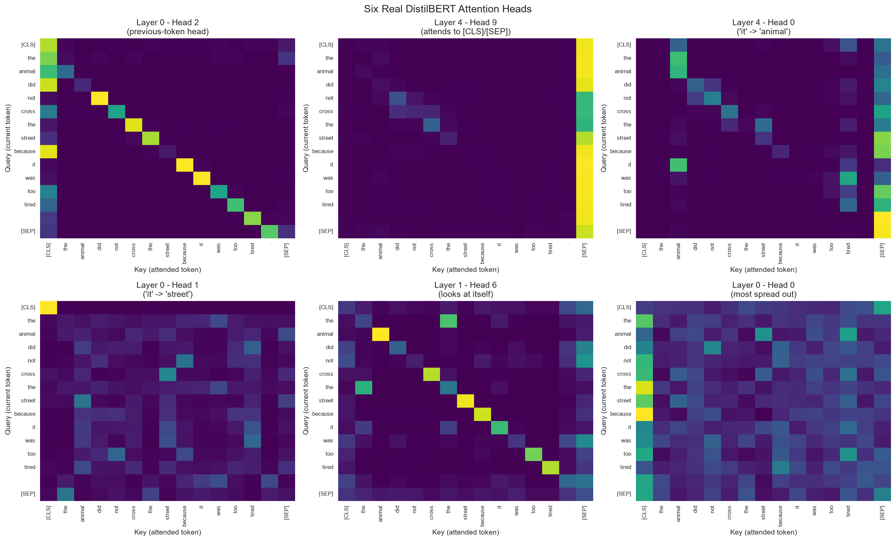
<br/>
<sub><i>🔭 Six real attention heads from DistilBERT — each head learns a different behaviour.</i></sub>
</div>

<br/>


## 🌟 Results at a Glance

<div align="center">

<table>
<tr>
<td align="center" width="20%"><h1>87%</h1><b>Accuracy</b><br/><sub>200 IMDB reviews<br/>no training!</sub></td>
<td align="center" width="20%"><h1>0.0</h1><b>Max difference</b><br/><sub>NumPy attention vs<br/>real DistilBERT</sub></td>
<td align="center" width="20%"><h1>4.9×</h1><b>KV-cache speed-up</b><br/><sub>12.4 s vs 60.7 s<br/>100 tokens</sub></td>
<td align="center" width="20%"><h1>67M</h1><b>Parameters</b><br/><sub>DistilBERT<br/>66,955,010</sub></td>
<td align="center" width="20%"><h1>3</h1><b>Model families</b><br/><sub>encoder · decoder<br/>enc-decoder</sub></td>
</tr>
</table>

</div>


## 🎯 About the Project

> **This project trains nothing.** It opens small pretrained Transformers from the 🤗 Hub, runs them, inspects their attention, **rebuilds the key equations in NumPy**, and proves the result matches the real model.


| 🔢 Task | 📚 Topic | ✅ What I did |
|:---:|---|---|
| **1** | Intro, History, Pipelines & Tokenizer | Sentiment pipeline, timeline, sub-words, padding, model anatomy |
| **2** | Self-Attention | Scaled dot-product in NumPy, √d_k experiment, Luong attention, order-blindness, **verified vs DistilBERT** |
| **3** | Multi-Head · Positional Encoding · LayerNorm | Real heads, entropy per head, sinusoidal vs learned positions, LayerNorm vs BatchNorm |
| **4** | Encoder & Masked Attention | Encoder anatomy, parameter chart, fill-mask, bidirectional vs causal, padding mask |
| **5** | Cross-Attention · Decoder · Inference | T5 translation, cross-attention map, manual greedy loop, 5 decoding strategies, KV-cache |
| **6** | Evaluation & Mini App | IMDB metrics, truncation study, cost vs length, hallucination check, `text_toolkit()` |


## 🤖 Models Used

| Family | 🤗 Exact Model ID | Architecture | Used for |
|:---:|---|:---:|---|
| 🟦 **Encoder** | [`distilbert-base-uncased-finetuned-sst-2-english`](https://huggingface.co/distilbert-base-uncased-finetuned-sst-2-english) | 6L · 12H · 768d | Sentiment, attention, anatomy, IMDB evaluation |
| 🟦 **Encoder** | [`distilbert-base-uncased`](https://huggingface.co/distilbert-base-uncased) | 6L · 12H · 768d | Fill-mask (bidirectional demo) |
| 🟩 **Decoder** | [`gpt2`](https://huggingface.co/gpt2) | 12L · 12H | Causal attention, generation, KV-cache, hallucination |
| 🟧 **Enc-Decoder** | [`t5-small`](https://huggingface.co/t5-small) | 6+6L · 8H | Cross-attention, translation, summarisation |

📦 **Data:** 200 reviews from the public [IMDB](https://huggingface.co/datasets/imdb) test split (`shuffle(seed=42)` → 96 positive / 104 negative) + 3 real text passages.


## 🧠 Core Concepts

### 1️⃣ &nbsp;Self-Attention — *Q, K, V* 🎯

<table>
<tr>
<td width="58%" valign="top">

Every token becomes **three vectors**:

- 🔍 **Query** — *what am I looking for?*
- 🔑 **Key** — *what do I offer?*
- 📦 **Value** — *what do I pass on?*

A token's new vector is a **weighted average of all Values**; weights come from Query·Key matches. All tokens are processed **in parallel** (unlike an RNN).

✅ My NumPy version of `softmax(QKᵀ/√d_k)·V` was **recomputed against layer-0, head-0 of the real DistilBERT** → `np.allclose = True`, max difference **0.0**.

🔀 Also shown: self-attention is **order-blind** — shuffling inputs just shuffles outputs.

</td>
<td width="42%" align="center">
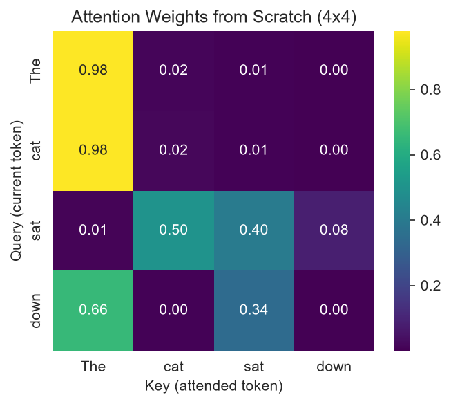
<sub><b>Fig 1.</b> 4×4 attention weights from scratch (rows sum to 1)</sub>
</td>
</tr>
</table>

<details>
<summary><b>📐 Why divide by √d_k? (click to expand experiment)</b></summary>
<br/>

Dot products grow with `d_k`, pushing softmax into a **saturated region** (one weight ≈ 1, vanishing gradients). Scaling keeps variance near 1.

| d_k | Scaling | Score std | Avg max prob | Entropy |
|:---:|:---:|:---:|:---:|:---:|
| 4 | ❌ without | 1.83 | 0.587 | 1.196 |
| 4 | ✅ with | 0.92 | 0.359 | 1.750 |
| 256 | ❌ without | **15.77** | **0.859** | **0.290** 🔥 |
| 256 | ✅ with | 0.99 | 0.362 | 1.707 |

*(max possible entropy for 8 tokens = ln 8 = 2.079)*

</details>

### 2️⃣ &nbsp;Multi-Head Attention 🧩

<table>
<tr>
<td width="50%" valign="top">

One pattern isn't enough. With **h heads**, `d_model` splits into smaller subspaces (**768 = 12 × 64**); each head has its own Q/K/V and pattern, then heads are concatenated and mixed by an output projection.

**Behaviours found** on *"The animal did not cross the street because it was too tired."*

| Head | Behaviour |
|---|---|
| L0 · H2 | 🔙 previous-token (66%) |
| L4 · H9 | 📌 [CLS]/[SEP] (89%) |
| L4 · H0 | 🔗 **"it" → "animal"** (69%) |
| L1 · H6 | 🪞 looks at itself |

</td>
<td width="50%" align="center">
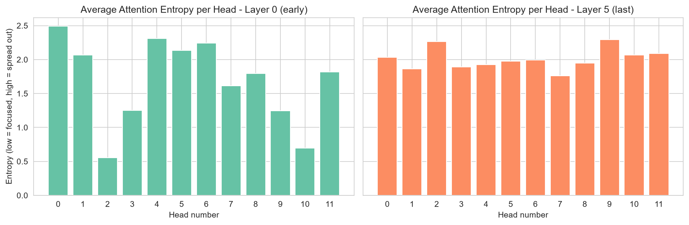
<sub><b>Fig 2.</b> Entropy per head. Layer-0 avg <b>1.69</b> vs last layer <b>2.01</b> — early heads vary more (modest, single-sentence observation).</sub>
</td>
</tr>
</table>

### 3️⃣ &nbsp;Positional Encoding 📍

Self-attention is order-blind, so position must be **added** to embeddings.

<div align="center">
<table>
<tr>
<td align="center" width="50%">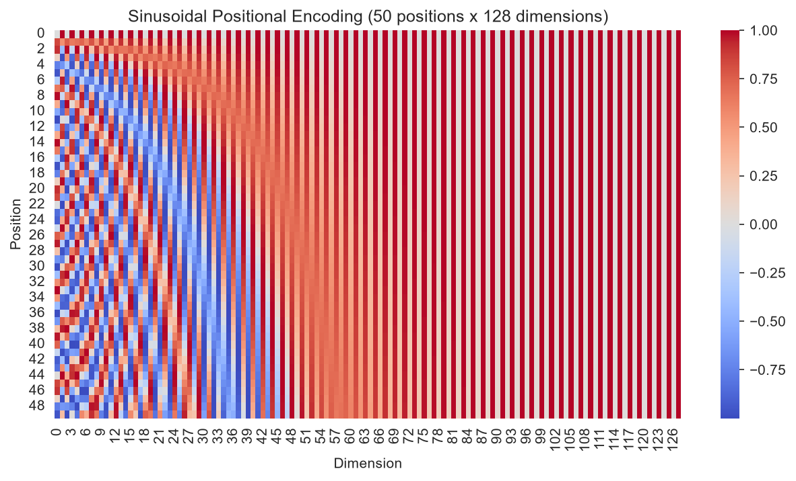<br/><sub><b>Fig 3a.</b> Sinusoidal PE (50 × 128)</sub></td>
<td align="center" width="50%">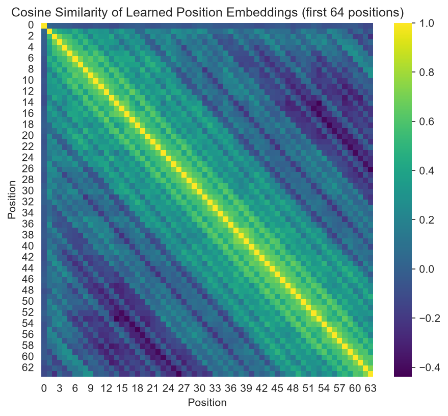<br/><sub><b>Fig 3b.</b> DistilBERT learned positions (cosine similarity)</sub></td>
</tr>
</table>
</div>

| Scheme | Used by | Key idea |
|---|:---:|---|
| 🌊 **Sinusoidal** | original Transformer | sin/cos of many frequencies → unique fingerprint per position |
| 📚 **Learned** | BERT / DistilBERT / GPT-2 | trainable **512 × 768** table → *origin of the 512-token limit* |
| ↔️ **Relative bias** | T5 | encodes distance between tokens |

💡 **Proof it works:** same word at positions 3 and 20 → cosine similarity **1.0** without PE, **0.8657** with PE.

### 4️⃣ &nbsp;Layer Normalization 📏

LayerNorm normalises **each token over its own features**: `y = γ·(x−μ)/√(σ²+ε) + β`.
✅ My NumPy version: per-token mean ≈ 0, std ≈ 1, and **matches `torch.nn.LayerNorm`**.

| | 🟢 LayerNorm | 🔴 BatchNorm |
|---|---|---|
| Normalised over | features of **one token** | **one feature** across batch |
| Depends on batch size | No | Yes |
| Variable length / padding | Works well | Awkward |
| Per-token means (demo) | `[0, 0, 0, 0]` ✅ | `[-0.27, 0.44, -0.30, 0.14]` ❌ |

🎚️ In DistilBERT, **γ (scale)** and **β (shift)** are learned vectors of shape `(768,)`.

### 5️⃣ &nbsp;Encoder & Masked (Causal) Attention 🔒

<table>
<tr>
<td width="50%" valign="top">

**Encoder block** =
`Multi-head attention` → `Add & Norm` → `Feed-forward (768→3072→768)` → `Add & Norm`

Every token sees **both directions** (57% of last-layer attention was above the diagonal, 28% below).

A next-word model must **not** see the future → add **−∞ above the diagonal *before* softmax**, so `e^(−∞)=0` and rows still sum to 1.

✅ NumPy mask: lower-triangular, rows sum to 1.
✅ **GPT-2**: largest value above diagonal = **0.0**.

</td>
<td width="50%" align="center">
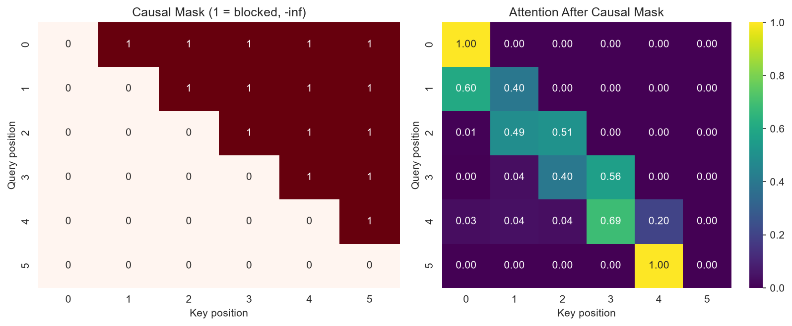
<sub><b>Fig 4.</b> Causal mask (left) → lower-triangular attention (right)</sub>
</td>
</tr>
</table>

<div align="center">
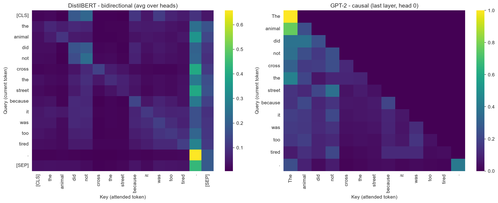
<br/><sub><b>Fig 5.</b> DistilBERT (bidirectional, full square) vs GPT-2 (causal, lower triangle)</sub>
</div>

<br/>

| | 🧱 Padding mask | 🔒 Causal mask |
|---|---|---|
| Purpose | Ignore `[PAD]` tokens | Block future tokens |
| Pattern | Columns of padded positions | Upper triangle |
| Used by | Any batched model (DistilBERT) | Decoders (GPT-2) |

Measured: attention received by padding = **0.00**.

<details>
<summary><b>📊 Where do the parameters live? (click to expand)</b></summary>
<br/>
<div align="center">
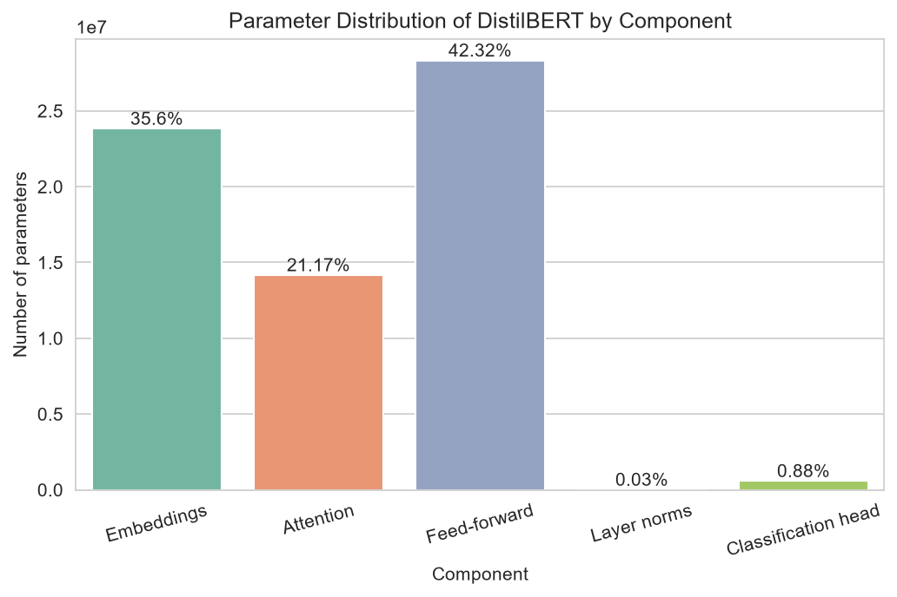
<br/><sub><b>Fig 6.</b> Feed-forward 42.32% · Embeddings 35.60% · Attention 21.17% · Head 0.88% · LayerNorm 0.03%</sub>
</div>
<br/>
Most knowledge sits in the <b>feed-forward layers</b> and <b>embeddings</b>; attention decides <i>where to look</i>.
</details>

### 6️⃣ &nbsp;Cross-Attention 🔀

<table>
<tr>
<td width="45%" valign="top">

**Queries** come from the **decoder**; **Keys & Values** come from the **encoder**. The decoder can look back at the source sentence while writing the target (same idea as Luong attention, inside a Transformer).

T5-small translating *"The house is small."* → *"La maison est petite."*

| Output | Top input | Weight |
|---|---|:---:|
| ▁maison | `:` (then `house` 0.26) | 0.32 |
| ▁petite | **▁small** ✅ | 0.27 |

> 🧐 Alignment is **partial**: "petite→small" is clean, but much attention also goes to the task prefix — averaging heads in a tiny model blurs the picture.

</td>
<td width="55%" align="center">
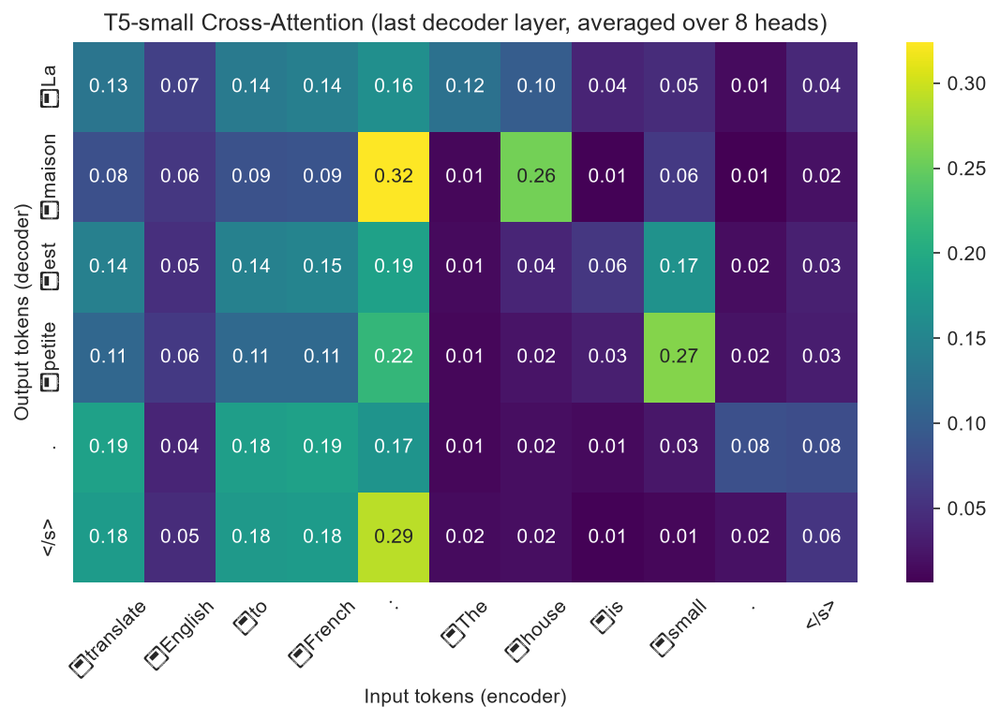
<sub><b>Fig 7.</b> T5-small cross-attention (rows = French, cols = English)</sub>
</td>
</tr>
</table>

### 7️⃣ &nbsp;Inference — One Token at a Time ⏱️

A decoder generates **one token**, appends it, and repeats. My manual GPT-2 greedy loop (*"Artificial intelligence will"*, 20 steps) is **identical** to `model.generate(do_sample=False)` 🎉

<div align="center">

| ⚡ KV-cache (100 tokens, CPU, avg of 3) | Time |
|:---:|:---:|
| `use_cache=True` | **12.42 s** |
| `use_cache=False` | 60.66 s |
| 🚀 **Speed-up** | **4.9×** |

</div>

Keys & Values of earlier tokens never change → **cache them** instead of recomputing.

<details>
<summary><b>🎲 Decoding strategies compared (click to expand)</b></summary>
<br/>

| Strategy | Behaviour | Unique-token ratio |
|---|---|:---:|
| (a) Greedy | deterministic, repetitive | 0.68 |
| (b) Beam search (5) | deterministic, repetitive | 0.65 |
| (c) Temperature 0.7 · 2 seeds | safer, predictable | 0.72 / 0.78 |
| (d) Temperature 1.5 · 2 seeds | very random, less coherent | 1.00 / 1.00 |
| (e) top-k 50 + top-p 0.9 | balanced diversity | 0.82 |

</details>

### 🧬 The Three Families Side by Side

| | 🟦 DistilBERT | 🟩 GPT-2 | 🟧 T5-small |
|---|:---:|:---:|:---:|
| **Family** | Encoder-only | Decoder-only | Encoder-decoder |
| **Attention** | Bidirectional self | Causal self | Self + causal + **cross** |
| **Generates text?** | ❌ | ✅ | ✅ |
| **Positions** | Learned | Learned | Relative bias |
| **Typical tasks** | Classification, fill-mask | Text generation | Translation, summarisation |


## 📊 Evaluation Results

> The sentiment model was **fine-tuned on SST-2 (short sentences)** — I did **not** train it — and is tested here on **full IMDB reviews** (200 reviews · `max_length=512` · `batch_size=16`).

<table>
<tr>
<td width="50%" valign="top">

| Metric | Score |
|---|:---:|
| ✅ **Accuracy** | **0.870** |
| 🎯 Precision | 0.889 |
| 🔁 Recall | 0.833 |
| ⚖️ F1-score | 0.860 |

**Confusion matrix:** 94 TN · 80 TP · 10 FP · 16 FN

</td>
<td width="50%" align="center">
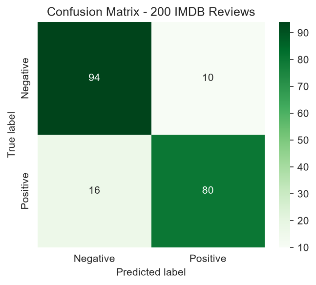
<sub><b>Fig 8.</b> Confusion matrix — 200 IMDB reviews</sub>
</td>
</tr>
</table>

### ✂️ Truncation Study

<table>
<tr>
<td width="42%" valign="top">

| max_length | Accuracy | Time |
|:---:|:---:|:---:|
| 64 | 0.750 | 22.4 s |
| 128 | 0.775 | 84.1 s |
| 256 | 0.840 | 151.0 s |
| **512** | **0.870** | 273.1 s |

📉 Shrinking 512 → 64 loses **12 points** of accuracy but is **~12× faster**.
📄 **18 / 200** reviews exceed 512 tokens and still lose text.

</td>
<td width="58%" align="center">
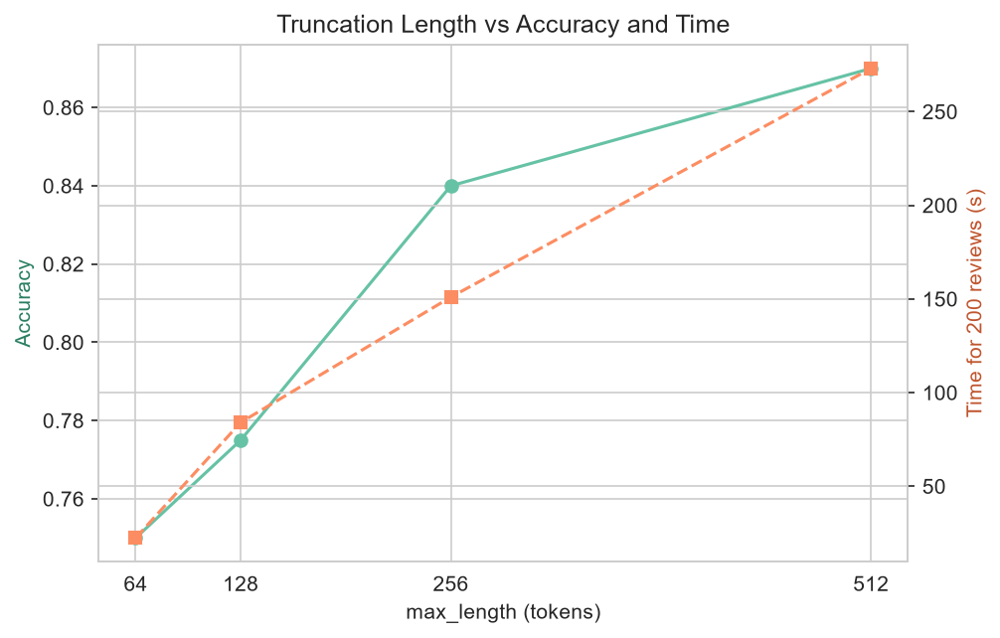
<sub><b>Fig 9.</b> Longer context → higher accuracy and higher cost</sub>
</td>
</tr>
</table>


## ⚠️ Two Measured Disadvantages

### 🅰️ Cost grows with sequence length 📈

<table>
<tr>
<td width="42%" valign="top">

DistilBERT forward pass (CPU, batch 1, avg of 10 runs):

| Tokens | Time (ms) |
|:---:|:---:|
| 32 | 114.9 |
| 64 | 149.6 |
| 128 | 177.0 |
| 256 | 545.1 |
| 512 | 867.6 |

16× longer input → only **7.6×** more time (fitted exponent **0.77**).

> 🧐 **Honest note:** on a small CPU with short inputs, linear parts (feed-forward, projections) dominate, so the curve looks closer to linear. The quadratic attention term takes over at longer lengths — which is why context windows are limited.

</td>
<td width="58%" align="center">
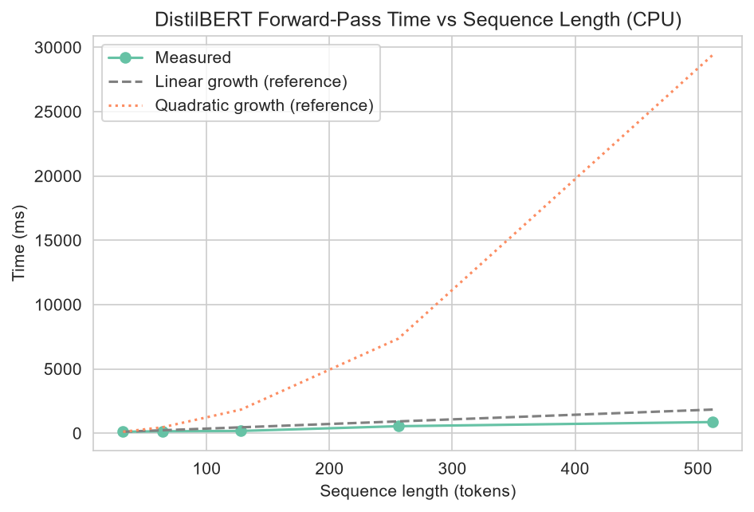
<sub><b>Fig 10.</b> Measured time vs sequence length (with linear & quadratic references)</sub>
</td>
</tr>
</table>

### 🅱️ Fixed context window & hallucination 🧱

- 🧱 **Context limit:** 18/200 reviews exceed 512 tokens; a 64-token window drops accuracy from **0.87 → 0.75**.
- 🤥 **Hallucination:** GPT-2 (greedy, 30 tokens) got **0 of 3** factual prompts right (*capital of Australia*, *author of Pride and Prejudice*, *inventor of the telephone*). It predicts the **most likely** words, not the **true** ones — never trust a generative model as a fact source without verification.


## 🛠️ Mini Application — `text_toolkit()`

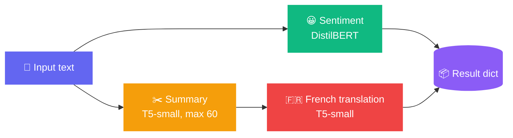

```python
result = text_toolkit("I went into this film with low expectations and was surprised ...")
# {'sentiment': 'POSITIVE', 'score': 0.9996, 'summary': '...', 'french': '...'}
```

✅ Tested on **3 real passages** (movie review · news paragraph · my own text) and shown as a pandas DataFrame.
🛡️ **Graceful handling:** empty text → clear message · very long text → truncated to 512 tokens with a note.

<details>
<summary><b>✨ More highlights (tokenizer, anatomy, fill-mask, translation) — click to expand</b></summary>
<br/>

**🔤 Tokenizer** — `"Transformers are surprisingly easy to understand."` → `[CLS] transformers are surprisingly easy to understand . [SEP]`. The rare word *Antidisestablishmentarianism* splits into 8 sub-words: `anti ##dis ##est ##ab ##lish ##ment ##arian ##ism`.

**🏗️ DistilBERT anatomy**

| Property | Value | Property | Value |
|---|:---:|---|:---:|
| Layers | 6 | Vocabulary | 30,522 |
| Heads | 12 | Max positions | 512 |
| Hidden size | 768 | Feed-forward | 3072 |
| Parameters | 66,955,010 | | |

**🎭 Fill-mask** (top-3)

| Sentence | Predictions |
|---|---|
| The capital of France is [MASK]. | marseille · nantes · toulouse |
| I went to the [MASK] to buy some bread. | bakery · market · kitchen |
| She opened the [MASK] and started to read. | door · book · notebook |

> The model uses words on **both sides** of `[MASK]`. (A small model isn't always right — "Paris" didn't make the top 3!)

**🌍 T5-small translation**

| English | French |
|---|---|
| The house is small and very old. | La maison est petite et très ancienne. |
| I would like a cup of coffee, please. | Je voudrais une tasse de café, je vous prie. |
| Machine learning is changing the world. | L'apprentissage des machines change le monde. |

A 161-word news paragraph was summarised to **54 words**.

</details>


## 🖼️ Plot Gallery

<div align="center">
<table>
<tr>
<td align="center"><br/><sub>Attention from scratch</sub></td>
<td align="center"><br/><sub>Entropy per head</sub></td>
<td align="center"><br/><sub>Sinusoidal PE</sub></td>
</tr>
<tr>
<td align="center"><br/><sub>Learned positions</sub></td>
<td align="center"><br/><sub>Parameter distribution</sub></td>
<td align="center"><br/><sub>Causal mask</sub></td>
</tr>
<tr>
<td align="center"><br/><sub>Bidirectional vs causal</sub></td>
<td align="center"><br/><sub>T5 cross-attention</sub></td>
<td align="center"><br/><sub>Confusion matrix</sub></td>
</tr>
<tr>
<td align="center"><br/><sub>Truncation vs accuracy</sub></td>
<td align="center"><br/><sub>Time vs length</sub></td>
<td align="center"><br/><sub>Six real heads</sub></td>
</tr>
</table>
</div>


## 🚀 Quick Start

```bash
# 1️⃣ Clone
git clone https://github.com/<your-username>/<your-repo>.git
cd <your-repo>

# 2️⃣ Install
pip install -r requirements.txt
pip install sentencepiece          # needed by the T5 tokenizer

# 3️⃣ Run
jupyter notebook DL_PR6.ipynb
```

> 💡 Models download automatically on first run (no account needed).
> ⚠️ Attention weights need `attn_implementation="eager"` + `output_attentions=True`.
> 🎲 Seeds fixed: `torch.manual_seed(42)` · `np.random.seed(42)`.

<details>
<summary><b>📦 requirements.txt & repository structure</b></summary>
<br/>

```text
transformers==4.52.4
torch==2.14.0
datasets==4.0.0
matplotlib==3.11.0
seaborn==0.13.2
numpy==2.5.4
pandas==2.3.3
scikit-learn==1.8.0
```

```text
📦 DL_PR6
 ┣ 📓 DL_PR6.ipynb
 ┣ 🌐 DL_PR6.html
 ┣ 📄 requirements.txt
 ┣ 📖 README.md
 ┗ 📁 plots/   (12 figures: attention_scratch, attention_heads, attention_entropy,
                positional_encoding, learned_positions, parameter_distribution,
                bidirectional_vs_causal, causal_mask, cross_attention,
                confusion_matrix, truncation_accuracy, time_vs_length)
```

</details>


## 🎥 Video Walkthrough

<div align="center">

### [▶️ **Click here to watch the 5–10 min video (face + screen)**](PASTE_YOUR_VIDEO_LINK_HERE)

</div>

Covers: Q/K/V & √d_k · multi-head · sinusoidal vs learned positions · LayerNorm vs BatchNorm · encoder vs decoder & masking · cross-attention · token-by-token inference & KV-cache · one measured disadvantage · **live `text_toolkit()` demo** on a new passage.


## 🎓 What I Learned

| 💬 | |
|---|---|
| 💪 **Understand best** | Self-attention, multi-head attention, positional encoding |
| 🌫️ **Still unclear** | Internal optimisation of very large Transformers, advanced attention variants |
| ✅ **Matched theory** | My from-scratch attention = DistilBERT's real attention; GPT-2's causal mask was a perfect lower triangle |
| 😲 **Surprised me** | Transformers process all tokens in parallel yet still link distant words |
| 📉 **Disadvantages measured** | ① cost 114.9 → 867.6 ms (32 → 512 tokens) ② accuracy 0.75 @ 64 tokens vs 0.87 @ 512, 18/200 reviews over the limit (+ GPT-2 got 0/3 facts) |
| 🍳 **App I'd build** | *AI Recipe Assistant* — Vision Transformer reads a fridge photo, an LLM suggests recipes |

<br/>

<div align="center">

### 👤 Author

**`Krisha Anghan`** &nbsp;·&nbsp; GRID: `10771`

[](https://github.com/krisha12345819/Deep-Learning-Transformer-Explorer-Attention-Encoder-Decoder-Inference>)
[](https://www.linkedin.com/in/krisha-anghan-bb1179382/>)


⭐ **If you liked this project, give it a star!** ⭐

</div>


